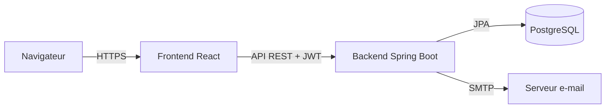

# 📚 BiblioSmart

> Système de gestion de bibliothèque universitaire : catalogue, emprunts, retours, réservations et pénalités, avec un code QR par exemplaire.


---

## 🎯 Pourquoi ce projet ?

Dans beaucoup de bibliothèques universitaires, les emprunts sont encore notés sur des registres papier. Résultat : des livres perdus, des retards mal suivis, et des étudiants qui se déplacent sans savoir si un ouvrage est disponible.

**BiblioSmart** digitalise tout le cycle de vie d'un livre : de son entrée au catalogue jusqu'à son retour, en passant par la réservation et le calcul automatique des pénalités.

## ✨ Fonctionnalités

### Étudiant
- 🔍 Rechercher un livre par titre, auteur, catégorie ou ISBN
- 📌 Réserver un livre indisponible (file d'attente)
- 📖 Consulter ses emprunts en cours, son historique et ses pénalités
- ⏳ Prolonger un emprunt une fois

### Bibliothécaire
- 📚 Gérer le catalogue et les exemplaires
- 📷 Enregistrer un emprunt ou un retour en scannant le code QR
- 👤 Inscrire les étudiants
- 💰 Enregistrer le paiement des pénalités

### Administrateur
- 👥 Gérer les comptes des bibliothécaires
- ⚙️ Paramétrer toutes les règles sans toucher au code : quotas, durées, pénalités, délais, devise et nom de la bibliothèque
- 📊 Consulter le tableau de bord et les statistiques

### Automatique (chaque nuit)
- ✉️ Rappels par e-mail avant l'échéance et en cas de retard
- 🧮 Calcul des pénalités de retard
- 🔔 Notification quand un livre réservé est disponible

## 🏗️ Architecture



## 🛠️ Stack technique

| Couche | Technologies |
| --- | --- |
| Backend | Java 21, Spring Boot 3 (Web, Data JPA, Security, Validation) |
| Base de données | PostgreSQL 16, migrations Flyway |
| Frontend | React, Vite, Tailwind CSS |
| Codes QR | ZXing (génération), html5-qrcode (scan) |
| Tests | JUnit 5, Mockito |
| Documentation API | springdoc-openapi (Swagger UI) |
| Déploiement | Docker, Docker Compose |

## 📂 Structure du projet

```
bibliosmart/
├── backend/        # API Spring Boot
├── frontend/       # Application React
├── docs/           # Cahier des charges et diagrammes UML
├── .gitignore
└── README.md
```

## 🚀 Installation

> ⚠️ Le projet est en cours de développement : cette section sera complétée au fil des étapes.

### Prérequis
- [Docker](https://www.docker.com/) et Docker Compose
- (Optionnel, pour développer) Java 21, Maven, Node.js 20

### Lancer le projet
```bash
git clone https://github.com/TON-PSEUDO/bibliosmart.git
cd bibliosmart
cp .env.example .env      # puis renseigner les variables
docker compose up
```

- Frontend : http://localhost:5173
- API : http://localhost:8080
- Documentation de l'API : http://localhost:8080/swagger-ui.html

## 📐 Documentation

- [Cahier des charges et modélisation UML](docs/cahier-des-charges.md) : besoins fonctionnels et non fonctionnels, règles de gestion, diagrammes de cas d'utilisation, de classes et de séquence

## 🗺️ Feuille de route

- [x] Cahier des charges et diagrammes UML
- [ ] Squelette Spring Boot, Docker Compose et base de données
- [ ] Authentification JWT et gestion des utilisateurs
- [ ] Catalogue, exemplaires et codes QR
- [ ] Emprunts, retours et réservations
- [ ] Pénalités, tâches planifiées et notifications
- [ ] Frontend React
- [ ] Tableau de bord et statistiques
- [ ] v2 : application mobile Flutter et paiement des pénalités par MTN Mobile Money ou Orange Money

## 📸 Captures d'écran

*À venir.*

## 👤 Auteur

**Maxime** — Étudiant en 3e année de Génie Informatique à l'École Nationale Supérieure Polytechnique de Yaoundé (ENSPY), Cameroun

## 📄 Licence

Ce projet est distribué sous licence MIT.
