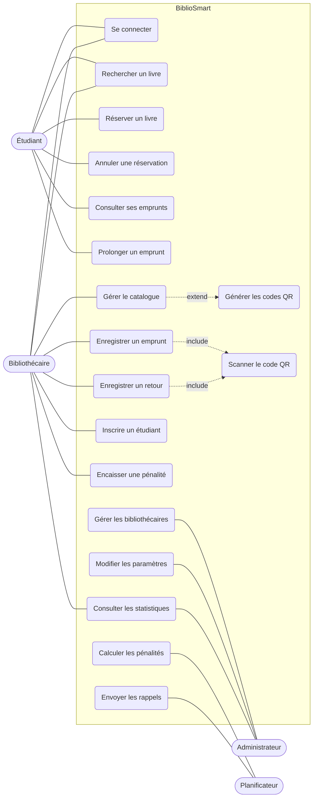
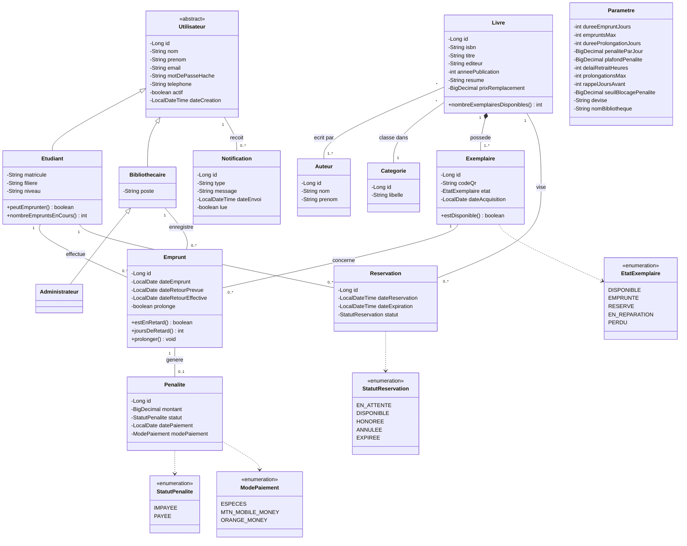
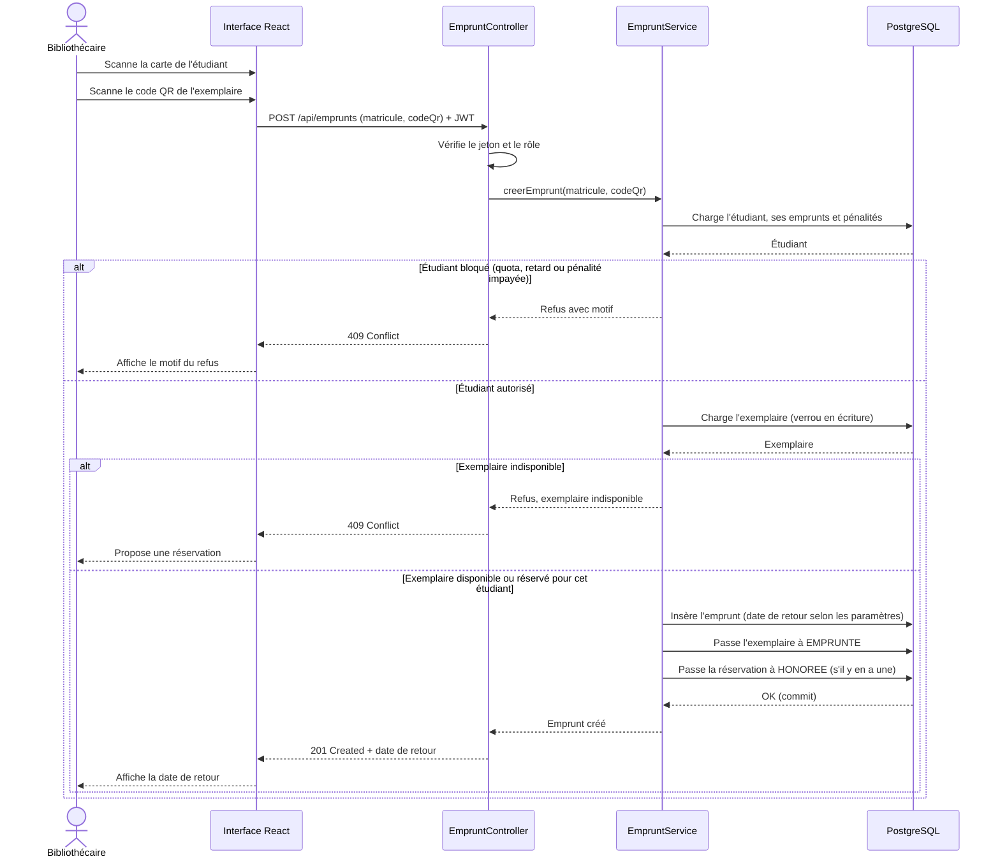

# BiblioSmart — Cahier des charges et modélisation UML

Version du 25 novembre 2026 · Maxime

BiblioSmart est une application web qui digitalise la gestion d'une bibliothèque universitaire : catalogue, emprunts, retours, réservations et pénalités, avec un code QR par exemplaire.

## 1. Présentation du projet

**Contexte.** Dans beaucoup de bibliothèques universitaires, les emprunts sont notés sur des registres papier ou des tableurs. On perd la trace des livres, les retards sont mal suivis et les étudiants ne savent pas si un ouvrage est disponible avant de se déplacer.

**Problématique.** Comment permettre à une bibliothèque de suivre chaque exemplaire en temps réel, d'automatiser les rappels et les pénalités, et de donner aux étudiants un accès en ligne au catalogue ?

**Objectifs.**

- Centraliser le catalogue et l'état de chaque exemplaire (disponible, emprunté, réservé, perdu)
- Réduire le temps d'un emprunt à moins d'une minute grâce au scan du code QR
- Calculer automatiquement les retards et les pénalités
- Permettre aux étudiants de chercher, réserver et suivre leurs emprunts en ligne
- Fournir des statistiques pour piloter la bibliothèque

**Périmètre.** La version 1 couvre une seule bibliothèque, en application web. Hors périmètre pour l'instant : le paiement en ligne des pénalités (MTN Mobile Money et Orange Money), les livres numériques et l'application mobile Flutter, prévus en version 2.

## 2. Acteurs et rôles

Trois acteurs humains utilisent le système ; un acteur système (le planificateur) déclenche les tâches automatiques.

| Acteur | Rôle | Droits principaux |
| --- | --- | --- |
| Administrateur | Responsable de la plateforme | Gère les comptes des bibliothécaires, fixe les paramètres (durée d'emprunt, montant des pénalités, nombre maximal d'emprunts), consulte toutes les statistiques |
| Bibliothécaire | Agent au comptoir | Gère le catalogue et les exemplaires, enregistre emprunts et retours, valide les réservations, encaisse les pénalités, inscrit les étudiants |
| Étudiant | Lecteur inscrit | Cherche dans le catalogue, réserve un livre, consulte ses emprunts, son historique et ses pénalités, prolonge un emprunt |
| Planificateur (système) | Tâche automatique quotidienne | Envoie les rappels avant échéance, calcule les pénalités de retard, annule les réservations expirées |

L'administrateur hérite des droits du bibliothécaire.

## 3. Besoins fonctionnels

Les besoins sont numérotés (BF-xx) pour être repris dans les issues GitHub. Priorité : **P1** = indispensable en v1, **P2** = souhaitable en v1, **P3** = v2.

| Code | Module | Besoin | Acteur | Priorité |
| --- | --- | --- | --- | --- |
| BF-01 | Authentification | Se connecter avec e-mail et mot de passe, se déconnecter | Tous | P1 |
| BF-02 | Authentification | Réinitialiser son mot de passe par e-mail | Tous | P2 |
| BF-03 | Utilisateurs | Créer, modifier, désactiver un compte bibliothécaire | Administrateur | P1 |
| BF-04 | Utilisateurs | Inscrire un étudiant (matricule, filière, niveau) | Bibliothécaire | P1 |
| BF-05 | Catalogue | Ajouter, modifier, supprimer un livre (titre, auteurs, ISBN, catégorie, éditeur, année) | Bibliothécaire | P1 |
| BF-06 | Catalogue | Gérer les exemplaires d'un livre et générer leur code QR | Bibliothécaire | P1 |
| BF-07 | Catalogue | Rechercher par titre, auteur, catégorie, ISBN, avec filtre de disponibilité | Tous | P1 |
| BF-08 | Emprunts | Enregistrer un emprunt en scannant le code QR de l'exemplaire | Bibliothécaire | P1 |
| BF-09 | Emprunts | Enregistrer un retour et libérer l'exemplaire | Bibliothécaire | P1 |
| BF-10 | Emprunts | Prolonger un emprunt, s'il n'est pas réservé | Étudiant | P2 |
| BF-11 | Emprunts | Consulter ses emprunts en cours et son historique | Étudiant | P1 |
| BF-12 | Réservations | Réserver un livre indisponible (file d'attente) | Étudiant | P1 |
| BF-13 | Réservations | Annuler sa réservation | Étudiant | P2 |
| BF-14 | Pénalités | Calculer automatiquement les pénalités de retard | Planificateur | P1 |
| BF-15 | Pénalités | Enregistrer le paiement d'une pénalité | Bibliothécaire | P1 |
| BF-16 | Notifications | Envoyer un rappel par e-mail avant l'échéance et le jour du retard | Planificateur | P2 |
| BF-17 | Notifications | Prévenir l'étudiant quand le livre réservé est disponible | Planificateur | P2 |
| BF-18 | Tableau de bord | Afficher les statistiques : livres les plus empruntés, retards, taux d'occupation | Administrateur, bibliothécaire | P2 |
| BF-19 | Paramètres | Modifier tous les paramètres configurables (quotas, durées, montants, délais, devise) | Administrateur | P1 |
| BF-20 | Paiement | Payer ses pénalités par MTN Mobile Money ou Orange Money | Étudiant | P3 |

## 4. Besoins non fonctionnels

| Code | Catégorie | Exigence |
| --- | --- | --- |
| BNF-01 | Sécurité | Authentification par jeton JWT, mots de passe hachés avec BCrypt, accès contrôlé par rôle sur chaque route de l'API |
| BNF-02 | Sécurité | Validation de toutes les entrées côté serveur, protection contre l'injection SQL (requêtes paramétrées via JPA) |
| BNF-03 | Performance | Recherche dans le catalogue en moins de 1 seconde pour 10 000 livres |
| BNF-04 | Ergonomie | Interface en français, responsive (utilisable sur téléphone), un emprunt en 3 clics maximum |
| BNF-05 | Fiabilité | Un exemplaire ne peut jamais être emprunté deux fois en même temps (transaction en base) |
| BNF-06 | Connexion lente | Pages légères et pagination des listes, pour rester utilisable avec une connexion 3G ou 4G instable |
| BNF-07 | Maintenabilité | Code organisé en couches (contrôleur, service, dépôt), tests unitaires sur les règles de gestion, couverture visée de 70 % |
| BNF-08 | Déploiement | Lancement complet (base, backend, frontend) avec une seule commande `docker compose up` |
| BNF-09 | Documentation | API documentée avec Swagger (OpenAPI), README avec captures d'écran et instructions d'installation |

## 5. Règles de gestion

Aucun nombre n'est écrit en dur dans le code : chaque valeur de ces règles (quotas, durées, montants, délais) est un paramètre, initialisé avec une valeur par défaut au premier démarrage et modifiable par l'administrateur (BF-19). Chaque bibliothèque qui installe BiblioSmart peut ainsi l'adapter à son règlement sans toucher au code. Les nombres écrits dans les règles ci-dessous sont les valeurs par défaut des paramètres listés juste après.

| Code | Règle |
| --- | --- |
| RG-01 | Un étudiant emprunte au plus **3 livres** en même temps |
| RG-02 | La durée d'un emprunt est de **14 jours** |
| RG-03 | Un emprunt peut être prolongé **une seule fois**, de 7 jours, si aucune réservation n'attend ce livre et si l'emprunt n'est pas en retard |
| RG-04 | Chaque jour de retard coûte **100 FCFA** par livre, plafonné à **5 000 FCFA** par emprunt |
| RG-05 | Un étudiant qui a une pénalité impayée ou un livre en retard ne peut ni emprunter ni réserver |
| RG-06 | Un livre ne peut être réservé que si aucun de ses exemplaires n'est disponible |
| RG-07 | Les réservations sont servies dans l'ordre d'arrivée (premier arrivé, premier servi) |
| RG-08 | Quand un exemplaire réservé revient, l'étudiant a **48 heures** pour venir le chercher ; sinon la réservation expire et passe au suivant |
| RG-09 | Un exemplaire a toujours un seul état : disponible, emprunté, réservé, en réparation ou perdu |
| RG-10 | Un livre perdu est facturé à son prix de remplacement, saisi dans la fiche du livre |
| RG-11 | Un livre qui a des exemplaires empruntés ne peut pas être supprimé du catalogue |

### Paramètres configurables

Ils sont stockés dans la table `parametre` (une seule ligne), remplie au premier démarrage avec les valeurs par défaut ci-dessous. Le code lit toujours ces valeurs via un service, jamais une constante.

| Paramètre | Clé dans le code | Valeur par défaut | Règle |
| --- | --- | --- | --- |
| Nombre maximal d'emprunts simultanés | `empruntsMax` | 3 | RG-01 |
| Durée d'un emprunt (jours) | `dureeEmpruntJours` | 14 | RG-02 |
| Nombre maximal de prolongations par emprunt | `prolongationsMax` | 1 | RG-03 |
| Durée d'une prolongation (jours) | `dureeProlongationJours` | 7 | RG-03 |
| Pénalité par jour de retard | `penaliteParJour` | 100 | RG-04 |
| Plafond de pénalité par emprunt | `plafondPenalite` | 5 000 | RG-04 |
| Montant impayé toléré avant blocage | `seuilBlocagePenalite` | 0 | RG-05 |
| Délai pour retirer un livre réservé (heures) | `delaiRetraitHeures` | 48 | RG-08 |
| Rappel avant la date de retour (jours) | `rappelJoursAvant` | 2 | BF-16 |
| Devise des montants | `devise` | FCFA | RG-04, RG-10 |
| Nom de la bibliothèque | `nomBibliotheque` | « Bibliothèque ENSPY » | Affichage, e-mails |

**RG-12 :** un changement de paramètre ne s'applique qu'aux **nouvelles** opérations. Un emprunt déjà en cours garde sa date de retour prévue et le tarif de pénalité en vigueur le jour de l'emprunt, pour qu'un étudiant ne soit jamais pénalisé par une règle changée après coup.

## 6. Diagramme de cas d'utilisation

L'administrateur hérite de tous les cas d'utilisation du bibliothécaire (non dessinés pour garder le schéma lisible).

**Description textuelle : Enregistrer un emprunt (UC7)**

- **Acteur** : bibliothécaire
- **Précondition** : le bibliothécaire est connecté ; l'étudiant est inscrit
- **Scénario nominal** :
    1. Le bibliothécaire saisit ou scanne le matricule de l'étudiant.
    2. Le système vérifie que l'étudiant n'a ni pénalité impayée ni retard, et qu'il n'a pas atteint son quota (RG-01, RG-05).
    3. Le bibliothécaire scanne le code QR de l'exemplaire.
    4. Le système vérifie que l'exemplaire est disponible, ou réservé pour cet étudiant.
    5. Le système crée l'emprunt avec une date de retour prévue (durée paramétrée, 14 jours par défaut) et passe l'exemplaire à « emprunté ».
    6. Le système affiche la date de retour.
- **Scénarios alternatifs** : étudiant bloqué → message avec le motif, emprunt refusé ; exemplaire indisponible → proposition de réservation.
- **Postcondition** : l'emprunt est enregistré et l'exemplaire n'est plus disponible.

**Description textuelle : Réserver un livre (UC3)**

- **Acteur** : étudiant
- **Précondition** : l'étudiant est connecté et n'est pas bloqué (RG-05)
- **Scénario nominal** :
    1. L'étudiant recherche un livre et ouvre sa fiche.
    2. Le système indique qu'aucun exemplaire n'est disponible et propose de réserver.
    3. L'étudiant confirme.
    4. Le système crée la réservation « en attente » et affiche sa position dans la file.
- **Scénario alternatif** : un exemplaire est disponible → la réservation est refusée et l'étudiant est invité à venir l'emprunter (RG-06).
- **Postcondition** : l'étudiant sera prévenu au retour d'un exemplaire (BF-17).

## 7. Diagramme de classes

Le modèle sépare le **Livre** (l'œuvre, décrite une fois) de l'**Exemplaire** (l'objet physique, avec son code QR) : on emprunte un exemplaire, mais on réserve un livre. Les noms sont sans accents pour être repris tels quels dans le code Java.

**Points de conception**

- `Utilisateur` est abstraite : en JPA, une seule table `utilisateur` avec une colonne `role` (stratégie `SINGLE_TABLE`) suffit pour trois rôles.
- `Parametre` n'a qu'une seule ligne en base : elle porte toutes les règles modifiables par l'administrateur (section 5).
- Le montant d'une `Penalite` est recalculé chaque nuit tant que le livre n'est pas rendu, puis figé au retour. Son mode de paiement est prévu dès la v1 (espèces au comptoir, BF-15) : la v2 ajoutera MTN Mobile Money et Orange Money (BF-20) sans changer la base de données.

## 8. Diagramme de séquence : emprunter un livre

L'emprunt ne passe que si les deux contrôles réussissent (étudiant autorisé, exemplaire disponible) ; tout se fait dans une seule transaction pour éviter un double emprunt (BNF-05).

## 9. Contraintes techniques, stack et planning

| Couche | Technologie | Pourquoi |
| --- | --- | --- |
| Backend | Java 21 + Spring Boot 3 (Web, Data JPA, Security, Validation) | Rejoint le cours de POO Java et Spring, très demandé en entreprise |
| Base de données | PostgreSQL 16 | Robuste, gratuit, gère bien les transactions (BNF-05) |
| Migrations | Flyway | Schéma de base versionné avec le code |
| Frontend | React + Vite + Tailwind CSS | Interface rapide et responsive |
| Codes QR | ZXing (génération côté serveur), html5-qrcode (scan via la caméra) | Bibliothèques libres et éprouvées |
| Tâches planifiées | `@Scheduled` de Spring | Rappels et pénalités chaque nuit |
| Tests | JUnit 5, Mockito | Tests des règles de gestion |
| Documentation API | springdoc-openapi (Swagger UI) | Documentation générée automatiquement |
| Déploiement | Docker + Docker Compose | Lancement en une commande |
| Versionnement | Git + GitHub (issues, branches, GitHub Actions) | Suivi du projet et intégration continue |

**Étapes du projet** (chaque étape est terminée et vérifiée avant de passer à la suivante)

1. Installer les outils (Git, Java 21, Node.js, Docker, éditeur)
2. Valider le cahier des charges (ce document)
3. Créer le dépôt GitHub et faire le premier push
4. Squelette Spring Boot et base PostgreSQL avec Docker
5. Entités JPA et création des tables
6. Authentification JWT et rôles
7. Catalogue, exemplaires et recherche
8. Codes QR des exemplaires
9. Emprunts et retours, avec tests des règles de gestion
10. Réservations et prolongations
11. Pénalités, tâches planifiées et e-mails
12. Paramètres et statistiques
13. Frontend React : connexion et menus par rôle
14. Écrans étudiant
15. Écrans bibliothécaire et administrateur, avec scan QR
16. Lancement complet avec `docker compose up` et tests de bout en bout
17. README final, documentation de l'API et publication de la version 1.0

**Décisions validées**

- Les quotas, durées et montants des règles de gestion sont validés comme valeurs par défaut, toutes modifiables par l'administrateur (paramètres configurables).
- Les notifications passent uniquement par e-mail, sans SMS, et font partie de la v1.
- Le paiement en ligne par MTN Mobile Money ou Orange Money est prévu en v2.
